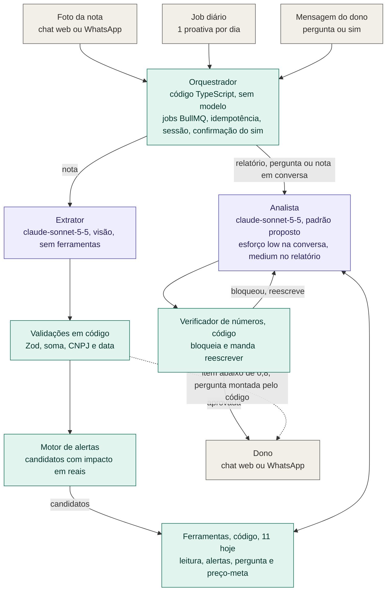

# Fluxo do agente

Entregável obrigatório do edital (inputs, lógica e outputs). Atualize junto com o código. Estado em 2026-10-21: o verificador (base da Etapa 0, #112), o registro de execuções (#57; PRs #112 e #131), o loop do Analista (#55), o histórico da conversa e `select_alerts` (PR #133) estão na `develop`; as ferramentas de leitura de métricas e `list_alert_candidates` também (PRs #145, #168, #169 e #174), `ask_owner` e `save_owner_answer` (PR #132) e a ação com confirmação do dono (`propose_target_price`, #104; PR #141), também na `develop`. A tabela de ferramentas abaixo marca o que já roda. A arquitetura (dois agentes mais um orquestrador em código) está na [decisão 0003](decisoes/0003-arquitetura-do-agente.md) e na [especificação dos agentes](especificacao-agentes.md).

## Dois agentes e um orquestrador em código

- **Extrator** (visão, sem ferramentas): foto da nota para JSON validado por Zod. Roda como job de ingestão, antes do loop abaixo.
- **Analista** (o loop abaixo): escolhe os alertas, responde perguntas e escreve a mensagem, com o verificador no fim.
- **Orquestrador**: código (BullMQ e PostgreSQL), não um agente. Decide ordem, limites, idempotência e resolve a confirmação "sim" do dono sem modelo.

Há ainda um terceiro uso de modelo, fora do loop: o sugestor de vínculo entre a descrição da nota e o produto (`src/ingestao/vinculo/sugestor-vinculo.ts`, gatilho registrado `vinculo_produto`, modelo `VINCULO_MODELO`, ativo quando há `ANTHROPIC_API_KEY`). Como o `extracao_nota` do Extrator, ele fica no registro de execuções fora da tabela de gatilhos do Analista abaixo.

Canal: hoje só o chat web está implementado (`CANAL=web`, o padrão). A WhatsApp Cloud API real ainda não existe (`CANAL=whatsapp` lança erro, #61 e #62), e o front `web/whatsapp` simula a conversa. O que é real e o que é simulado está em `src/canal/README.md`.



Roxo: agente com modelo de linguagem. Verde: código determinístico. Cinza: entrada e saída. A arquitetura de módulos e dados está em [arquitetura.md](arquitetura.md).

O diagrama a seguir detalha o loop do Analista.

## Visão geral

```
gatilho ──▶ AgenteService.executar
              │
              ├─ mensagem_dono com ação pendente e "sim" ou "não" explícito
              │     ─▶ ConfirmacaoDoDono resolve em código e responde, sem chamar o modelo
              │
              ├─ monta a entrada: histórico curto da conversa + mensagem atual
              │     (tudo como dado delimitado: <mensagem_do_dono>, <conteudo_de_documento>)
              │
              └─ loop (até AGENTE_MAX_ITERACOES e AGENTE_TIMEOUT_MS)
                   ├─ modelo.gerar(system, messages, tools, esforço do gatilho)
                   │     · API repete 408, 409, 429, 5xx e erro de conexão (LLM_MAX_RETRIES)
                   ├─ stop_reason = tool_use  ─▶ RegistroFerramentas.executar (em paralelo)
                   │                              · valida entrada com Zod
                   │                              · comerciante_id vem da sessão
                   │                              · escrita só com confirmação do dono
                   │                              · resultado alimenta os números autorizados
                   ├─ stop_reason = end_turn  ─▶ verificador de números
                   │                              · aprovado: mensagem pronta
                   │                              · bloqueado: pede correção (até AGENTE_MAX_REGERACOES)
                   │                              · esgotou: fallback sem números
                   ├─ refusal                 ─▶ fallback de recusa
                   └─ erro, timeout, limite   ─▶ fallback de erro
              │
              └─ grava execucao_agente + chamada_ferramenta ──▶ devolve RespostaAgente
                                                                  (quem envia é o canal, MessageChannel)
```

O agente não envia nada: devolve a mensagem já aprovada e o canal a entrega. Por isso `send_message` não é ferramenta; deixar o modelo enviar abriria um caminho que pula o verificador (decisão 0003).

### Relatório diário, passo a passo

1. O job (plano C) dispara `relatorio_diario` com a data de referência da execução.
2. O modelo chama `list_alert_candidates`, que devolve os candidatos já ordenados por prioridade e, dentro dela, por impacto em centavos e depois confiança, com tipo e chave no último desempate (conta do código).
3. Escolhe até 3 e registra a escolha com `select_alerts`, uma justificativa curta por alerta. A ferramenta confere os ids contra os candidatos do comerciante na data e devolve só dados do banco (as métricas de apoio), que passam a ser as fontes dos números. A justificativa é texto do modelo: fica na entrada da chamada, para os bastidores, e não volta na saída. Sem `select_alerts` bem-sucedido (ou sem candidato), o loop não aprova o relatório.
4. Escreve uma frase por alerta, com o valor e a ação sugerida.
5. O verificador confere cada número. Aprovada, a mensagem volta ao canal. A decisão (quais alertas e por quê) fica em `chamada_ferramenta`, na ordem, e alimenta a tela de bastidores.

### Ação com confirmação do dono, passo a passo

A única escrita do agente é a configuração do próprio comerciante (preço-meta, ou o custo que o dono informa). Ela nunca roda por decisão do modelo (regra inviolável 7):

1. O modelo chama `propose_target_price` (ou `save_owner_answer`). O registro vê que a ferramenta é `escreve_config`, não executa e guarda a proposta em `pergunta_dono` (tipo `confirmar_acao`, com ferramenta, entrada, resumo e `expira_em`). Só uma proposta fica pendente por comerciante: a nova cancela a anterior.
2. A ferramenta devolve a pergunta ao dono, montada em código (por exemplo, `Quer que eu registre R$ 12,90 como preço-meta de "Arroz"? Responda sim ou não.`). O que o dono confirma é exatamente esse texto, então ele é obrigatório na mensagem: se o modelo não o incluir, a mensagem enviada é a própria pergunta, sem reescrita. O trecho é isento da conferência de números, porque o valor dele é o que o dono vai aprovar e o nome do produto é cadastro, não quantidade.
3. O dono responde. No início de `executar`, `ConfirmacaoDoDono` olha a mensagem antes de qualquer modelo:
   - a mensagem inteira igual a uma frase explícita ("sim", "pode", "isso mesmo") reivindica a proposta, executa a escrita uma única vez e responde com o aviso montado em código; dois "sim" ao mesmo tempo gravam uma vez só;
   - "não" cancela e nada muda;
   - proposta vencida (`ACAO_EXPIRA_MINUTOS`) vira `expirada` e o dono é avisado; nada muda;
   - qualquer outra mensagem ("sim, mas com 15,90", uma pergunta nova) não confirma nada e **cancela a proposta pendente**: a proposta só vale para a resposta imediata. Assim um "sim" dito mais tarde, a outra pergunta, nunca aplica uma configuração velha. O mesmo vale quando o sistema envia algo por conta própria (relatório diário ou nota processada).
4. A escrita depende da ferramenta; o código de confirmação não conhece nenhuma delas:
   - `propose_target_price` grava o valor vigente em `produto` e uma linha nova em `historico_preco_meta` (append-only, com o valor anterior e confiança 1);
   - `save_owner_answer` grava só uma linha nova em `historico_custo` (origem `dono`, confiança 1), ligada à linha mais recente de `historico_custo` do mesmo produto e fornecedor (sem ela, a ferramenta falha), sem tocar em `produto` nem em `historico_preco_meta`.

   A mudança de estado da proposta e a escrita acontecem na mesma transação: se o processo cair no meio, nada foi gravado e o mesmo "sim" ainda vale. Falha na escrita cancela a proposta e o dono recebe um aviso sem número.
5. A resolução fica registrada como uma execução (`modelo = codigo`, zero tokens) com a chamada `confirm_pending_action`, para aparecer nos bastidores.

### Conversa, passo a passo

1. O canal grava a mensagem recebida e carrega o histórico (`carregarHistorico`, últimas `AGENTE_HISTORICO_TURNOS` falas de `mensagem`, sem a atual e sem os avisos montados de nota ou pergunta de nota, que são dado do documento).
2. `executar` recebe o histórico em `PedidoAgente.historico`. Falas do dono entram entre `<mensagem_do_dono>`, com a marcação higienizada; falas do assistente entram como texto.
3. O modelo escolhe a ferramenta que responde. Se nenhuma serve, diz que não sabe e que dado faltaria; se falta um dado do dono, pergunta (`ask_owner`).
4. Números de falas anteriores não autorizam nada: um valor dito antes pode estar velho. Para repetir um número o modelo busca de novo na ferramenta, e só o que a ferramenta devolve nesta execução (mais o que o dono escreveu na mensagem atual) passa no verificador.

## Inputs

| Gatilho | Origem | Entrada |
| --- | --- | --- |
| `mensagem_dono` | Chat web ou WhatsApp | Texto do dono, delimitado como dado, mais o histórico curto da conversa |
| `relatorio_diario` | Job diário (BullMQ) | Pedido de relatório com até 3 alertas |
| `nota_processada` | Fim da extração de uma nota | Resumo da nota, delimitado como dado |

O `ContextoSessao` (comerciante, nome do comércio, data de referência) é montado pelo código a partir de quem está falando. O modelo nunca o escolhe.

Limites e esforço vêm do ambiente. Os nomes e os valores padrão moram em [`src/config/env.ts`](../src/config/env.ts) (e em `.env.example`); aqui só o que cada um controla:

- `AGENTE_MAX_ITERACOES`: chamadas ao modelo por execução.
- `AGENTE_TIMEOUT_MS`: prazo total da execução. Vale também com uma chamada ao modelo ou uma ferramenta em andamento: a chamada ao modelo é cancelada e a ferramenta deixa de ser esperada (ela não é interrompida e termina sozinha). Estourado o prazo, o dono recebe o fallback de erro.
- `AGENTE_MAX_REGERACOES`: correções pedidas ao modelo, tanto depois de o verificador bloquear quanto quando o relatório diário chega sem a escolha dos alertas registrada.
- `AGENTE_HISTORICO_TURNOS`: falas anteriores enviadas ao modelo (zero desliga o histórico).
- `ACAO_EXPIRA_MINUTOS`: validade de uma ação à espera do "sim" do dono.
- `LLM_ESFORCO_CONVERSA` e `LLM_ESFORCO`: esforço do modelo na conversa e no relatório diário e na nota processada.
- `LLM_TIMEOUT_MS` e `LLM_MAX_RETRIES`: tempo de cada chamada ao modelo e novas tentativas da API, com espera exponencial.

## Lógica

- **Ferramentas** (`src/agente/ferramentas`): cada uma declara nome, descrição, esquema Zod estrito e efeito (`nenhum`, `pergunta_dono`, `escreve_config`). O registro recusa ferramenta que receba `comerciante_id` do modelo e nome repetido. Erro de ferramenta volta ao modelo como `tool_result` com `is_error`, sem derrubar o fluxo. Ferramenta que escreve configuração só executa depois de o dono confirmar (regra inviolável 7); sem confirmação ligada ao banco, nenhuma escrita roda. O catálogo junta as listas dos três planos (`catalogo.ts`).

| Ferramenta | Efeito | Situação em 2026-10-21 |
| --- | --- | --- |
| `get_daily_summary`, `get_top_products` | nenhum | Pronta (#50, #148; PRs #145 e #169): `get_top_products` aceita os critérios `volume`, `alta` e `receita`, com a janela até ontem (como `get_period_summary` sem `ate`); `get_daily_summary` sem data resume ontem (#211) |
| `get_period_summary` | nenhum | Pronta (#182): semana ou mês até a data (sem data, até ontem), contra o período anterior |
| `get_product_margin`, `get_cost_changes` | nenhum | Pronta (#51; PR #145). `get_product_margin` também acha descrições confirmadas pelo dono e distingue produtos de mesmo nome (#156; PR #168) |
| `list_product_margins` | nenhum | Pronta (melhoria pedida pelo dono): lista as margens dos produtos sem precisar do nome (menor, maior, abaixo da meta) e diz o total que atende ao filtro, para as perguntas de margem sem produto |
| `list_alert_candidates` | nenhum | Pronta (#52; PR #174): roda o motor de alertas para o comerciante da sessão e o dia anterior à data dela (#211), sem entrada do modelo |
| `select_alerts` | nenhum | Pronta (#133): até 3 ids com justificativa, conferidos contra o comerciante e a data |
| `ask_owner`, `save_owner_answer` | `pergunta_dono`, `escreve_config` | Pronta (PR #132) |
| `propose_target_price` | `escreve_config` | Pronta (PR #141): só propõe; o preço-meta muda quando o dono diz sim (ver abaixo) |

Detalhe de cada ferramenta e das prioridades na [especificação dos agentes](especificacao-agentes.md), seção 4.
- **Contrato de retorno** (`src/metricas/resultado-metrica.ts`): valor, período, número de registros e menor confiança. Dinheiro em chaves `*_centavos`, percentuais prontos para exibir em `*_percentual`. Dado ausente é explícito (`{ ausente: true, motivo }`).
- **Verificador de números** (`src/lib/verificador-numeros`): extrai números da mensagem em português ("R$ 1.234,50", "-12,5%", "15/10") e confere com os resultados das ferramentas daquela execução, os números escritos pelo dono e a data de referência. A comparação preserva o sinal e não arredonda. Única exceção: percentual negativo de chave `_percentual` (-7.29) pode ser dito em módulo se uma palavra de direção coerente estiver ao lado ("queda de 7,29%", "caiu 7,29%", "7,29% abaixo"); sem a palavra, ou com direção contrária ("alta de 7,29%"), é bloqueado, e dinheiro e contagem seguem exigindo o sinal. Cardinais por extenso detectados (como "quinhentos reais" e "trinta por cento") são bloqueados mesmo quando o valor existe nas fontes; a correção pede algarismos antes de validar novamente. "Um/uma" são tratados como numerais quando isolados ou acompanhados de unidades/contagens do domínio, preservando artigos em frases como "mande uma planilha".
- **Prompt de sistema** versionado em `src/agente/prompts/`, um arquivo por versão que nunca é editado depois de usado: mudar o comportamento é criar a versão seguinte, para o registro de execuções e o eval saberem qual prompt produziu cada resultado. O padrão é `sistema-v5.md`; o v1, o v2, o v3 e o v4 continuam no repositório. O v3 manda chamar `select_alerts` antes de escrever o relatório, citar resultados das ferramentas sem dizer que fez a conta, buscar de novo qualquer número dito antes na conversa, avisar que a reação das vendas a uma mudança de preço é desconhecida, propor o preço-meta só por `propose_target_price` e usar `ask_owner` e `save_owner_answer` para o dado que só o dono sabe. O v4 acrescenta: chamar `list_alert_candidates` primeiro nas perguntas de parado, reajuste, "posso subir o preço" e gasto fora do normal, dizer em uma linha o que dá para responder quando não der, recusar em uma frase os pedidos de mudar regra ou ver outro comércio, e pedir a planilha, uma vez, quando faltarem vendas de um período; usar `list_product_margins` para menor ou maior margem e para quantos produtos estão abaixo da meta. O v5 acrescenta: citar o nome do produto e os números principais devolvidos pela ferramenta (2 a 4 linhas), abrir o "não sei" com uma frase clara sem outros números, e recusar injeção em uma frase só, sem repetir número do pedido.
- **Falhas** (nenhuma envia número que o verificador não aprovou):

| Falha | Comportamento | Resultado gravado |
| --- | --- | --- |
| Ferramenta devolve erro ou entrada inválida | Volta ao modelo com `is_error`; o limite de iterações encerra se ele insistir | `aprovada` ou `fallback_erro` |
| Ferramenta sem dado | Devolve `{ ausente: true, motivo }`; o agente diz que não sabe ou pergunta; número inventado para preencher é bloqueado | `aprovada` |
| Verificador bloqueia | Pede correção até `AGENTE_MAX_REGERACOES`; depois, mensagem de fallback sem números; no chat, texto livre sem proposta pendente vira o menu de opções (#192) | `fallback_verificador` |
| Relatório diário sem escolha registrada (nenhum `select_alerts` bem-sucedido e `list_alert_candidates` não informou zero candidatos) | Pede a escolha ao modelo, até `AGENTE_MAX_REGERACOES`; depois, fallback de erro. O relatório sem registro da decisão não é enviado | `fallback_erro` |
| Timeout, rede, erro da API, resposta sem texto, resposta cortada ou limite de tempo ou de iterações | API repete o que vale repetir; esgotado, mensagem de fallback sem números e o motivo em `erro` | `fallback_erro` |
| Recusa do modelo | Mensagem de recusa sem números | `recusa_modelo` |
| Escrita confirmada falha (ex.: produto removido entre a proposta e o "sim") | A proposta é cancelada, nada é alterado e o dono recebe um aviso sem números | `fallback_erro` |
| Resolução do "sim" lança exceção | Fallback de erro, sem chamar o modelo (a proposta pode já ter sido reivindicada: nunca se confirma algo não feito) | `fallback_erro` |

## Outputs

- Mensagem para o canal: aprovada pelo verificador ou um fallback sem números (no chat, o menu de opções quando o texto livre é barrado e não há proposta pendente).
- Registro em `execucao_agente`: gatilho, entrada, modelo, versão do prompt, resultado (`aprovada`, `fallback_verificador`, `fallback_erro`, `recusa_modelo`), iterações, bloqueios do verificador com os números barrados, tokens, custo estimado, latência e erro.
- Registro em `chamada_ferramenta`: cada chamada em ordem, com entrada, saída, erro, menor confiança e latência. Base da tela de bastidores. A resolução de um "sim" entra como chamada `confirm_pending_action`, feita pelo código.
- Consulta (sempre filtrada pelo comerciante da sessão): `GET /execucoes` (mais recentes), `GET /execucoes/:id` (execução com as chamadas em ordem) e `GET /execucoes/verificador/bloqueios?de=AAAA-MM-DD&ate=AAAA-MM-DD`.

## Onde fica o estado

PostgreSQL (dados, histórico, execuções e as mensagens da conversa, lidas a cada execução) e Redis/BullMQ (filas e jobs). Nada em memória do processo: o agente recebe o histórico montado do banco e não guarda nada entre execuções.

## Métrica de degradação

Taxa de bloqueio do verificador: execuções com `bloqueios_verificador > 0` sobre o total de execuções do Analista com modelo (a extração de notas e a confirmação do "sim" resolvida em código não passam pelo verificador e ficam de fora), por dia no fuso do dono, em pontos-base. Sai de `GET /execucoes/verificador/bloqueios`, junto com o número de fallbacks do verificador. Uma alta da taxa indica que o modelo ou o prompt degradou.
