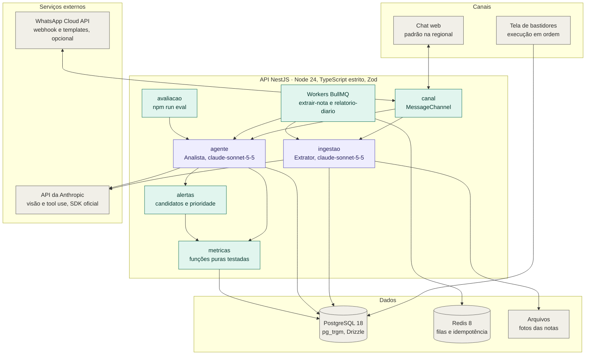

# Arquitetura do projeto

Visão dos módulos, dos dados e dos serviços externos do Omnia. O fluxo de execução dos agentes está em [agent-flow.md](agent-flow.md); a decisão por trás dele, em [0003 · Arquitetura do agente](decisoes/0003-arquitetura-do-agente.md); o detalhe de cada agente, na [especificação dos agentes](especificacao-agentes.md).

Os modelos abaixo são os propostos na especificação. O padrão em `src/config/env.ts` ainda é `claude-opus-5-5` (decisão 0002) até a troca para o Sonnet ser feita e medida no `npm run eval`.

Roxo: módulo com modelo de linguagem. Verde: código determinístico. Cinza: canal, infraestrutura e serviços externos.

## Módulos (`src/`)

| Módulo | Responsabilidade | Issues |
| --- | --- | --- |
| `canal` | Interface `MessageChannel`: troca chat web por WhatsApp sem mexer no agente | #66, #106 |
| `ingestao` | Upload e extração de notas (Extrator), validações em código, importação da planilha de vendas | #22 a #28 |
| `agente` | Analista: loop com ferramentas, prompt versionado, verificador de números e registro de execuções | #53, #55, #57 |
| `metricas` | Margem, giro, variação de custo, ticket médio e anomalias, em funções puras com teste | #32 a #41 |
| `alertas` | Motor de regras: candidatos a alerta com prioridade e impacto em reais | #43 a #46 |
| `avaliacao` | Conjunto de testes do agente em um comando, com relatório salvo | #67 a #74 |
| `lib` | Componentes isolados e reaproveitáveis: dinheiro em centavos e verificador de números | #8, #56 |
| `infra` | PostgreSQL (Drizzle) e Redis | #3, #5 |

## Modelos por papel

| Papel | Modelo | Observação |
| --- | --- | --- |
| Extrator | `claude-sonnet-5-5` | Visão, sem ferramentas. Variável `EXTRATOR_MODELO` |
| Analista | `claude-sonnet-5-5` | `claude-opus-5-5` só se o eval mostrar ganho. `LLM_MODELO` e `LLM_ESFORCO` |
| Orquestrador e verificador | Nenhum | Código |

## Estado

PostgreSQL guarda dados do lojista, histórico de custo, execuções do agente e confirmações pendentes. Redis e BullMQ guardam filas, jobs e chaves de idempotência (comerciante e data). Nenhum estado fica em memória do processo (regra inviolável 11).
