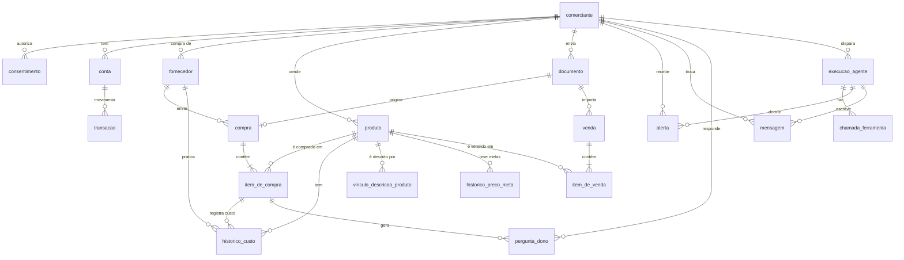

# Modelo de dados

Dono do fato: `src/infra/database/schema.ts` (Drizzle). Migrações em `drizzle/`. Este arquivo explica o desenho e traz o diagrama; se divergir do schema, o schema vence.

## Regras que valem para todas as tabelas

| Regra | Como o banco garante |
| --- | --- |
| Dinheiro em centavos inteiros | Colunas `bigint` com sufixo `_centavos`. Nenhum `numeric` ou `float` para dinheiro |
| `comerciante_id` em toda tabela com dado do lojista | Coluna `NOT NULL` com índice e chave estrangeira para `comerciante` |
| Isolamento entre lojistas | Tabela filha aponta para a mãe por chave composta `(id, comerciante_id)`. O banco recusa um item de venda do lojista A ligado à venda do lojista B |
| Origem e confiança em todo dado extraído ou informado | Colunas `origem` (`foto_nota`, `nfe`, `planilha`, `banco`, `dono`) e `confianca` (0 a 1, com `CHECK`) |
| Histórico nunca é sobrescrito nem apagado | `historico_custo`, `historico_preco_meta`, `limite_alerta` e `vinculo_descricao_produto` são append-only (gatilho `bloquear_alteracao_historico`) |
| Exclusão a pedido do lojista (LGPD) | `DELETE` em `comerciante` apaga tudo em cascata, inclusive o histórico |
| Nenhum estado em memória do processo | Perguntas pendentes ao dono, alertas e mensagens ficam no banco |

## Diagrama

Toda tabela, exceto `comerciante`, também aponta para `comerciante` (omitido no diagrama para não poluir).

## Tabelas

| Tabela | Para que serve | Pontos de atenção |
| --- | --- | --- |
| `comerciante` | Lojista. Nome, WhatsApp, tipo e `margem_meta_bps` (meta de margem, 2500 = 25%) | A meta é configuração do próprio lojista, a única escrita permitida ao agente, e só após confirmação |
| `consentimento` | O que foi autorizado (`banco`, `notas`), quando e em qual versão do termo; `revogado_em` quando revogado | Uma linha por concessão |
| `conta` | Conta bancária conectada. Guarda só o id da conexão no agregador, nunca credenciais | `saldo_inicial_centavos` e `saldo_inicial_em` permitem calcular o saldo de qualquer dia; `ultima_sincronizacao_em` guarda o último dia com extrato importado por inteiro, a data de corte e não o dia da execução (separa "sem movimento" de "sem importação"); é data de controle da conta, não dado de negócio, então fica fora da origem e da confiança por registro da regra 4 |
| `transacao` | Entrada ou saída da conta, com `id_externo` único por conta para importar sem duplicar | Valor sempre positivo; o sentido está em `tipo` |
| `fornecedor` | Nome e CNPJ (só dígitos), único por comerciante | CNPJ ilegível ou com dígito errado entra nulo: cada nota vira um fornecedor próprio até o dono confirmar, em vez de juntar notas de fornecedores diferentes |
| `produto` | Catálogo. Código de barras e SKU únicos por comerciante, índice `pg_trgm` no nome | `preco_meta_centavos` e `margem_meta_bps` são as metas do dono, opcionais |
| `documento` | Arquivo enviado (foto, NF-e, planilha), com hash SHA-256 único por comerciante, status da extração (`pendente`, `processando`, `extraido`, `revisao`, `falha`), a saída do modelo já validada (`extracao_json`) e as divergências achadas em código (`motivos_validacao`) | O mesmo arquivo enviado duas vezes não vira dois documentos |
| `compra` | Nota de compra: fornecedor, data, total impresso e soma dos itens calculada em código | Total diferente da soma reduz a confiança |
| `item_de_compra` | Linha da nota. `produto_id` é nulo até a descrição ser ligada a um produto | `revisao_pendente` quando a confiança fica abaixo do limite. A resposta do dono tira a pendência e não altera a confiança da linha |
| `vinculo_descricao_produto` | Descrição impressa na nota para produto, com o método (`codigo_barras`, `similaridade`, `modelo`, `dono`) | **Append-only**. Trocar um vínculo insere linha nova; vale a mais recente da chave. Só `confirmado_pelo_dono` vale como memória: o vínculo por similaridade fica registrado sem confirmação, para auditoria |
| `historico_custo` | Custo por produto, fornecedor e data, uma linha por leitura do item de compra | **Append-only**. A confirmação do dono insere linha nova (origem `dono`, confiança 1, limitada à do vínculo com o produto) e vale a mais recente do item. Alimenta margem e variação de custo |
| `historico_preco_meta` | Cada preço-meta que o dono confirmou para um produto, com o valor vigente antes (`anterior_centavos`), origem `dono` e confiança 1 | **Append-only** (migração `0008_historico_preco_meta`). `produto.preco_meta_centavos` guarda só o valor vigente; o anterior nunca é apagado. A única escrita do agente, e só depois do "sim" do dono (regra 7) |
| `limite_alerta` | Limites de alerta que o dono ajustou, uma linha por limite (`limite` é um campo de `LimitesDeAlerta` ou `janelaSupressaoDias.<tipo>`), com origem `dono` e confiança 1 | **Append-only**: vale a linha mais recente de cada limite; sem linha vale o padrão. `valor` nulo só nas janelas de supressão (sem limite de idade). A escrita pelo agente, quando existir, só depois do "sim" do dono (regra 7) |
| `mapeamento_planilha` | Mapeamento de colunas de uma planilha de vendas (data, produto, quantidade, preço), identificado pela assinatura dos cabeçalhos e confirmado pelo dono uma vez | Único por `(comerciante, assinatura)` |
| `venda` e `item_de_venda` | Cupom e seus itens, vindos da planilha ou do PDV | `(comerciante, data, numero_cupom)` único: reimportar não duplica |
| `alerta` | Candidato a alerta com tipo, prioridade (1 a 3), números de apoio em JSON, status (`candidato`, `enviado`, `descartado` ou `obsoleto`) e justificativa do agente | `(comerciante, tipo, chave, data)` único: o motor é idempotente |
| `mensagem` | Mensagem enviada ou recebida, categoria do template, custo estimado e canal | No máximo uma proativa por dia por comerciante; chave de idempotência do job única |
| `pergunta_dono` | Pergunta do agente ao dono e a resposta, com status | Substitui qualquer estado de conversa em memória. O tipo `confirmar_acao` guarda a escrita à espera do "sim" (ferramenta, entrada, resumo e `expira_em` no `contexto`); só uma fica pendente por comerciante |
| `execucao_agente` e `chamada_ferramenta` | Observabilidade: gatilho, tokens, custo, latência, resultado do verificador e cada chamada de ferramenta | Já existiam desde a Etapa 0 |

## Histórico append-only

`UPDATE` em `historico_custo`, `historico_preco_meta`, `limite_alerta` e `vinculo_descricao_produto` sempre falha. `DELETE` só passa em dois casos:

1. Em cascata, quando o lojista pede a exclusão (LGPD): o gatilho detecta que roda dentro de outro gatilho (`pg_trigger_depth() > 1`).
2. Quando a transação declara `SET LOCAL omnia.exclusao_autorizada = 'on'`, que a rotina de retenção e o seed usam.

Isso protege o ativo próprio do projeto (edital, seção 9.4): custo por produto, fornecedor e data, e vínculos confirmados pelo dono.

## Seed

`npm run seed:demo` zera o banco, aplica as migrações e carrega os `fixtures/`. `npm run db:seed` só recarrega. `npm run demo:reset` leva a demo ao estado inicial sem zerar o banco: aplica as migrações, recria só os comerciantes do seed, limpa os jobs e os arquivos deles (pausa as filas enquanto roda, então outros comerciantes esperam alguns segundos), e imprime os links do chat e dos bastidores (roda no host, não na imagem de produção). Detalhes em [fixtures/README.md](../fixtures/README.md).

O seed cria dois comerciantes, para testar o isolamento:

| Comerciante | Conteúdo |
| --- | --- |
| Mercadinho Vila Nova | Os fixtures inteiros: 50 produtos, 7 fornecedores, 18 notas, 3.623 cupons, 212 transações, 1 pergunta pendente |
| Conveniência Esquina 24h | Recorte menor: 12 produtos, últimas 2 semanas de vendas, meta de margem de 30%. O extrato bancário do período é o mesmo do primeiro lojista (só vendas, compras e catálogo são recortados), então os gastos dos dois coincidem |

É idempotente e determinístico: os ids são UUIDs v5 de nomes fixos e as datas de criação são fixas, então `db:reset && db:seed` deixa o banco sempre no mesmo estado. Recusa rodar com `NODE_ENV=production`.
