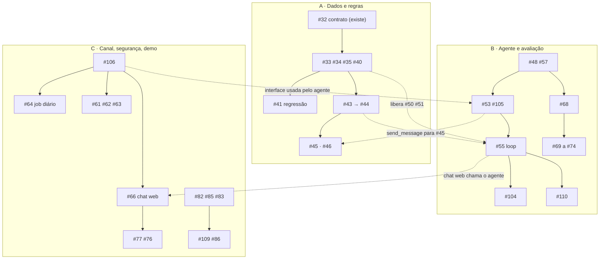

# Protocolo: escolher plano e issues antes de desenvolver

Três pessoas, cada uma com um plano de Claude Code, trabalham ao mesmo tempo. Para não quebrar o projeto, cada plano tem pastas próprias. Este protocolo é o dono da divisão; o estado do trabalho mora em `ESTADO.md`.

## Antes de desenvolver, pergunte ao usuário

Antes de escrever qualquer código, pergunte (uma pergunta só, com as opções abaixo):

1. Qual plano você está seguindo: **A** (dados e regras), **B** (agente e avaliação) ou **C** (canal, segurança e demo)?
2. Quais issues deste plano quer desenvolver nesta sessão? Sugira o próximo grupo da ordem do plano.

Só prossiga depois da resposta. Se o usuário já informou plano e issues na mensagem, confirme em uma linha e siga. Trabalhe só nas pastas do plano escolhido; se a tarefa exigir outra pasta, avise antes.

## Contexto de prazo

- Congelamento do código: sábado 24/10/2026 às 15h30. Prioridade: menor ciclo ponta a ponta (nota, métrica, alerta, agente, verificador, mensagem). Issues `prioridade:P0` primeiro.
- Ponto de partida (2026-10-20): Etapa 2 (ingestão) na `develop`; `src/metricas`, `src/alertas`, `src/canal` e `src/avaliacao` ainda são casca. Números atuais em `ESTADO.md`.

## Planos

| Plano | Pastas só dele | Ordem das issues |
| --- | --- | --- |
| **A** Dados e regras | `src/metricas`, `src/alertas` | 1. #33 margem, #34 giro, #35 variação de custo, #40 resumo diário, #41 regressão contra o gabarito (funções puras, sem dependência). 2. #43 motor de regras, #44 priorização, #46 teste sem falso alarme. 3. #45 job de reajuste (precisa do `send_message` do B). 4. P1/P2: #36, #38, #39, #37. |
| **B** Agente e avaliação | `src/agente`, `src/avaliacao` | 1. #48 cliente LLM com custo, #57 registro/LLMOps, #53 ask_owner/save_owner_answer/send_message, #105 erros. 2. #55 loop diário e conversa. 3. #50, #51, #52 (ligar ferramentas depois que o A mesclar as métricas). 4. #104 ação com confirmação. 5. #68 harness de eval, depois #69 a #74. 6. #110 `docs/agent-flow.md`. |
| **C** Canal, segurança e demo | `src/canal`, `src/comerciante`, `src/infra`, testes de segurança | 1. #106 implementar `MessageChannel` (memória e web), #66 chat web (plano B), #64 job diário idempotente. 2. #82 isolamento, #85 exclusão LGPD, #83 consentimento. 3. #77 bastidores, #76 reset da demo. 4. #109 retenção, #86 log de acesso. 5. P1 WhatsApp: #61, #62, #63 (#59 bloqueada). 6. #79 gravação, #111 checklist de congelamento. |

Dependências: o B usa ferramentas falsas atrás do contrato do #32 até o A mesclar as métricas.

## Fora dos planos de código

- Trabalho humano: #59 (bloqueada), #60, #80 a #103 (entrevistas, pitch, slides, concorrentes, custos), #30 (fora do escopo regional).
- Possivelmente já prontas, conferir e fechar: épicos #1 e #11, #7 (existe `ci.yml`), #16 (Etapa 1 feita), #108. Para #27 falta só a sugestão do modelo.
- Cortar se o tempo apertar: #29, #107, #37, #60 e o WhatsApp real (#61 a #63); o chat web cobre a demo.

## Regras para não colidir

1. Branch própria a partir da `develop` atualizada, PRs pequenos por grupo de issues (ex.: `feature/33-34-35-metricas`), mesclar cedo.
2. Pontos de colisão: `src/app.module.ts` e `registro-ferramentas.ts` ganham uma linha por módulo, então faça `git pull origin develop` antes de commitar neles.
3. Migrações: faixas reservadas. C usa 0006 a 0009, B usa 0010 a 0013, A usa 0014 em diante.
4. `docs/ESTADO.md`: só o plano A roda o `/checkpoint`; B e C deixam os números no corpo do PR.
5. Antes de abrir PR: `npm run lint && npm run typecheck && npm test && npm run test:e2e` (Node 24). Issues `regra-inviolável` (#64, #82) exigem teste que prove a regra.

## Economia de tokens

- Uma sessão por grupo de issues, `/clear` entre grupos.
- Prompt curto: leia `docs/ESTADO.md` e só a seção do guia da issue, implemente as issues escolhidas e mexa só nas pastas do plano.
- Leia seções (`grep -n '^## '`), mande saída longa para `evidencias/`.
- Modelo menor para implementação e testes; reserve o maior para o loop do agente (#55) e a revisão final.
- Rode `/auditoria` só ao fechar cada PR.
