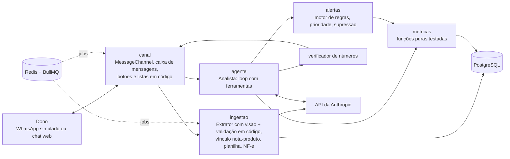

# Relatório final do projeto Omnia

Retrato do projeto às vésperas do congelamento do código (sábado 24/10/2026, 15h30). Escrito em 23/10/2026 sobre a `develop` em `13583d2` (depois dos PRs 181, 190, 191, 192 e 193). Este relatório resume e aponta: os números vivos continuam com seus donos (`docs/ESTADO.md`, `docs/avaliacoes/`), e cada número citado aqui traz a data e o relatório de onde saiu.

## 1. O que é

O Omnia é um agente de IA que avisa o dono de mercadinho ou conveniência, pelo WhatsApp, o que importa no negócio: margem abaixo da meta, reajuste de fornecedor, giro de produtos, ticket médio em queda, gasto fora do padrão e estoque parado. O dono manda fotos das notas de compra e a planilha de vendas do PDV; o sistema calcula as métricas, escolhe até 3 avisos por dia e conversa em português simples.

Persona: o dono de um comércio pequeno, sem tempo nem sistema de gestão, que já vive no WhatsApp. A pergunta que guiou a demo foi "estou lucrando em cima do que mais vende?", respondida em menos de um minuto.

## 2. Princípio central: o código calcula, o modelo comunica

Toda a arquitetura parte de uma ideia: modelo de linguagem não faz conta. Ele escolhe a ferramenta, lê o resultado e redige; o número sempre vem de uma função determinística e testada. Um verificador em código confere cada número da mensagem antes do envio e bloqueia o que não aparece nos resultados das ferramentas daquela execução.

As 12 regras invioláveis (em `AGENTS.md`) derivam disso. As que mais moldaram o código:

| Regra | Como aparece no sistema |
| --- | --- |
| Nenhum número sem função determinística | Métricas em funções puras; verificador de números em `src/lib/verificador-numeros` |
| Dinheiro em centavos inteiros | Colunas `bigint` `*_centavos`, `src/lib/dinheiro`, lint bloqueia `parseFloat` |
| `comerciante_id` da sessão, nunca do modelo | O registro de ferramentas recusa ferramenta cujo esquema aceite `comerciante_id`; chaves compostas `(id, comerciante_id)` no banco |
| Origem e confiança em todo dado | Colunas `origem` e `confianca` com `CHECK`; métricas devolvem a menor confiança dos dados usados |
| Saída de visão validada por Zod e conferida em código | Esquema de extração, conferência de somas, quantidade x unitário, CNPJ e data |
| Texto de nota ou do dono é dado, não instrução | Entrada delimitada (`<mensagem_do_dono>`, `<conteudo_de_documento>`) e casos de injeção no eval |
| Agente só informa e sugere | A única escrita é configuração do dono (preço-meta, custo informado), e só depois do "sim" |
| Histórico nunca apagado | Gatilho `bloquear_alteracao_historico` nas tabelas append-only |
| No máximo 1 mensagem proativa por dia | Chave de idempotência (comerciante + data) no job e restrição no banco |
| Nenhum estado em memória | PostgreSQL e Redis/BullMQ; até as travas usam `pg_advisory_xact_lock` |

## 3. Tecnologias

| Camada | Escolha | Por quê |
| --- | --- | --- |
| Linguagem e runtime | TypeScript estrito, Node 24 | Tipos de ponta a ponta, do banco ao esquema da ferramenta |
| Framework | NestJS 12 | Módulos e injeção de dependência casam com a separação por domínio |
| Banco | PostgreSQL 18 com `pg_trgm` | Transações, chaves compostas para isolamento, similaridade de texto para ligar descrição de nota a produto |
| ORM e migrações | Drizzle (`drizzle-orm`, `drizzle-kit`) | SQL explícito, migrações legíveis, `sql` cru para `pg_trgm` (decisão 0001) |
| Filas e jobs | Redis 8 + BullMQ | Extração assíncrona de notas, relatório diário com `jobId` idempotente, retentativas exponenciais |
| Validação | Zod 4 | Variáveis de ambiente, entrada das ferramentas, saída do modelo com visão |
| Modelo de linguagem | API da Anthropic pelo SDK oficial, `claude-sonnet-5-5` como padrão; Haiku para sugestão de vínculo | Tool use e visão no mesmo modelo; o Opus só entra se o eval mostrar ganho (decisão 0002) |
| Planilhas e XML | `csv-parse`, `exceljs`, `saxes` | CSV e XLSX do PDV; NF-e em XML lida sem modelo |
| Logs | Pino (`nestjs-pino`) com id de correlação | O mesmo id acompanha a requisição e os jobs que ela dispara |
| Testes | Jest, Supertest, `node --test` no front | Unitários, e2e com PostgreSQL e Redis reais, front do WhatsApp |
| Infra | Docker Compose, Dockerfile multi-estágio | `docker compose up` sobe banco, Redis e API com migrações |
| CI | GitHub Actions | Lint, Prettier, typecheck, deriva de migrações, testes, e2e, build, gitleaks e build da imagem |

## 4. Arquitetura

Um monólito modular em NestJS. Dois agentes com modelo de linguagem, ligados por um orquestrador que é código, não agente (decisão 0003, "híbrido mínimo").



| Módulo (`src/`) | Responsabilidade |
| --- | --- |
| `ingestao` | Upload de foto e XML, fila de extração, Extrator, validações, perguntas ao dono, vínculo com o catálogo, importação de planilha de vendas e de extrato |
| `metricas` | Margem, variação de custo, giro, receita por produto, resumo do dia, da semana e do mês, ticket médio, gasto fora do padrão, estoque parado, espaço para subir preço |
| `alertas` | Sete regras que viram candidatos a alerta, prioridade por impacto em reais, supressão, ciclo de status (`candidato`, `enviado`, `descartado`, `obsoleto`), limites por comerciante |
| `agente` | Loop do Analista, registro de ferramentas, prompts versionados, confirmação do dono, histórico da conversa, registro de execuções |
| `canal` | `MessageChannel`, chat web, WhatsApp simulado no formato da Cloud API, relatório diário, painel e tela de bastidores |
| `avaliacao` | `npm run eval`, `eval:extracao` e `eval:custo`, com relatório salvo em `docs/avaliacoes/` |
| `lib` | Dinheiro, verificador de números, CNPJ, GTIN, datas, uuid |
| `infra` | Banco (schema, migrações, seed), Redis, armazenamento de arquivos, logs |
| `comerciante` | Sessão do comerciante (provisória: cabeçalho `X-Comerciante-Id` conferido no banco) |

Detalhe: [arquitetura.md](arquitetura.md), [agent-flow.md](agent-flow.md), [especificacao-agentes.md](especificacao-agentes.md).

### Modelo de dados

21 tabelas em 13 migrações (`drizzle/0000` a `0012`). Núcleo: `comerciante`, `fornecedor`, `produto`, `documento`, `compra`, `item_de_compra`, `historico_custo`, `venda`, `item_de_venda`, `conta`, `transacao`, `alerta`, `mensagem`, `pergunta_dono`, `execucao_agente`, `chamada_ferramenta`. Pontos de desenho:

- Isolamento entre lojistas garantido pelo banco: a tabela filha aponta para a mãe por `(id, comerciante_id)`, então um item do lojista A não liga à venda do lojista B nem por erro de código.
- Histórico append-only por gatilho (`historico_custo`, `historico_preco_meta`, `limite_alerta`, `vinculo_descricao_produto`). Corrigir um custo é inserir uma linha nova com origem `dono` e confiança 1; a leitura do modelo continua lá.
- Exclusão LGPD em cascata a partir de `comerciante`.

Detalhe: [modelo-de-dados.md](modelo-de-dados.md).

## 5. Fluxos ponta a ponta

### 5.1 Nota de compra (foto)

1. O dono manda a foto pela conversa. `POST /chat/notas` guarda o arquivo, cria o `documento` como `pendente` e enfileira `extrair-nota` no BullMQ.
2. O worker chama o **Extrator** (Sonnet com visão, sem ferramentas). A saída passa pelo esquema Zod.
3. O código confere somas, quantidade x valor unitário, CNPJ (dígito verificador) e data. Divergência não descarta: reduz a confiança e registra o motivo.
4. Fornecedor, compra e itens são gravados numa transação, com origem `foto_nota` e confiança.
5. **Vínculo nota-produto**, em ordem: código de barras (quando a origem traz), vínculo já confirmado pelo dono, similaridade `pg_trgm` com folga sobre o segundo candidato e, por último, sugestão do Haiku, que nunca liga sozinha: vira "Parece ser X?" para o dono confirmar.
6. Item abaixo de 0,8 de confiança, item sem produto ou dúvida na nota inteira geram uma pergunta montada em código, com botões ou lista na conversa. A resposta tocada é resolvida sem modelo.
7. O dono recebe a leitura da nota montada do banco (fornecedor, itens, total, soma conferida). O job pós-nota roda o motor de alertas para pegar reajuste de custo na hora.

A NF-e em XML segue o mesmo caminho sem modelo (parse determinístico). A planilha de vendas (CSV ou XLSX) é identificada pela assinatura dos cabeçalhos; na primeira vez o dono confirma o mapeamento de colunas, depois importa direto.

### 5.2 Relatório diário (proativo)

1. O agendador BullMQ cria um job por comerciante com `jobId = relatorio_<comerciante>_<data>`; horário de silêncio adia o envio.
2. O Analista chama `list_alert_candidates`: o motor roda as sete regras, ordena por prioridade (impacto em reais em centavos, depois confiança) e suprime o que já foi enviado na janela.
3. O modelo escolhe até 3 com `select_alerts`, que confere os ids no banco e devolve as métricas de apoio. Sem essa escolha registrada, o relatório não é aprovado.
4. O modelo escreve uma frase por alerta. O verificador confere cada número; se bloquear, pede correção; se esgotar, sai um fallback sem números.
5. O canal entrega. Só depois da entrega confirmada os alertas escolhidos viram `enviado`; os não escolhidos continuam candidatos.
6. Fora da janela de 24 h do WhatsApp sai o modelo `resumo_diario`, preenchido em código, sem modelo de linguagem.

### 5.3 Conversa

1. A mensagem do dono é gravada e o histórico curto é carregado do banco.
2. Se há uma proposta pendente e o dono disse "sim" ou "não" explícito, o código resolve sem chamar o modelo.
3. Senão, o Analista escolhe entre as ferramentas de leitura (`get_daily_summary`, `get_period_summary`, `get_top_products`, `get_product_margin`, `get_cost_changes`, `list_alert_candidates`), responde, diz que não sabe e qual dado faltaria, ou pergunta ao dono (`ask_owner`).
4. Números ditos antes na conversa não autorizam nada: para repetir, o modelo consulta de novo.
5. O verificador aprova ou barra; o canal entrega o texto e escolhe em código os botões e listas.

### 5.4 Ação com confirmação

`propose_target_price` e `save_owner_answer` nunca escrevem direto. O registro guarda a proposta em `pergunta_dono`, devolve a pergunta montada em código ("Quer que eu registre R$ 12,90 como preço-meta de ...? Responda sim ou não.") e só grava quando o dono responde "sim" logo em seguida. Qualquer outra mensagem cancela a proposta; proposta vencida expira. A troca de estado e a escrita acontecem na mesma transação, e dois "sim" simultâneos gravam uma vez só.

## 6. Features entregues

| Área | Entregue |
| --- | --- |
| Ingestão | Foto de nota com visão, NF-e em XML, planilha de vendas CSV/XLSX com mapeamento confirmado, extrato bancário, perguntas ao dono, correção com histórico, vínculo nota-produto em 4 camadas |
| Métricas | 10 métricas determinísticas com contrato único (valor, período, nº de registros, menor confiança, origens) e dado ausente explícito, nunca estimado |
| Alertas | 7 regras, prioridade por impacto em reais, supressão por janela, candidato obsoleto quando o dono corrige um dado, recálculo de reajuste em ordem estável, limites por comerciante |
| Agente | Loop manual com 10 ferramentas, prompt versionado (`sistema-v3`), verificador com regeração, fallbacks sem número, timeout e limite de iterações, histórico de conversa, ação com confirmação do dono |
| Canal | `MessageChannel` com chat web (plano B) e WhatsApp simulado no formato da Cloud API: status lido e "digitando", botões, listas, modelo fora da janela de 24 h, leitura de nota na conversa |
| Telas | `/whatsapp` (demo), `/painel` (resumo do dia, semana e mês, produtos abaixo da meta), `/bastidores` (cada execução com as chamadas de ferramenta em ordem, bloqueios do verificador, confiança por item) |
| Observabilidade | `execucao_agente` e `chamada_ferramenta` com tokens, custo, latência, resultado e bloqueios; taxa de bloqueio do verificador por dia como métrica de degradação |
| Avaliação | Três runners com relatório versionado: agente (55 casos), extração (17 fotos) e custo/tempo |
| Demo | Dataset fixo gerado com semente, `npm run seed:demo`, `npm run demo:reset`, `DEMO_DATA_REFERENCIA` para fixar a data |

## 7. Métodos de trabalho

- **Gabarito antes do código.** A Etapa 1 gerou por script, com semente fixa, um mercadinho fictício de 61 dias: 50 produtos, 7 fornecedores, vendas, extrato, 17 notas "fotografadas" e uma NF-e, com reajustes plantados. As métricas esperadas são calculadas à parte (`scripts/fixtures/gabarito.ts`) e o e2e `tests/metricas-gabarito` compara dia a dia. Um teste falha se os arquivos versionados divergirem do gerador.
- **Etapas com critério de pronto.** Nove etapas (base, dados, ingestão, métricas, alertas, agente, canal, avaliação, demo), uma milestone e um épico cada; só se avança quando o critério passa. Prioridade no menor ciclo ponta a ponta (issues `prioridade:P0`).
- **Três planos paralelos.** A equipe dividiu o trabalho em planos A (ferramentas de leitura e métricas), B (ingestão e agente) e C (canal e jobs), com regras de colisão em `docs/protocolos/divisao-planos.md`.
- **Fluxo Git.** Branch por issue a partir da `develop`, commits pequenos com prefixo convencional, PR com `Closes #N` e revisão (humana e de agentes como Codex e Claude). PRs em regras invioláveis exigem teste que prove a regra.
- **Documentação com dono único.** Cada fato vive em um arquivo; os demais apontam. `docs/ESTADO.md` é o "você está aqui" de cada sessão; decisões numeradas em `docs/decisoes/`; protocolos de checkpoint e auditoria para agentes de código.
- **Evidência versionada.** Toda rodada de eval gera relatório em `docs/avaliacoes/` com data, modo, modelo, versão do prompt e comando. Falhas são analisadas por causa antes de mexer no prompt (`analise-falhas-22-10.md`).
- **Prompt imutável depois de usado.** Mudar comportamento é criar `sistema-vN+1.md`, para cada execução registrada saber qual prompt a produziu.

## 8. Resultados medidos

| O quê | Resultado | Fonte |
| --- | --- | --- |
| Testes unitários | 1269 passam em 88 suítes | `npm test`, 22/10 (ESTADO) |
| Testes e2e (PostgreSQL e Redis reais) | 555 passam em 40 suítes | `npm run test:e2e`, 22/10 (ESTADO) |
| Testes do front do WhatsApp | 25 passam | `npm run test:web`, 22/10 (ESTADO) |
| Métricas e alertas contra o gabarito | Batem | e2e `tests/metricas-gabarito` |
| Extração de notas, modelo real | 17 de 17 totais certos; 521 de 523 campos (99,6%); 2 erros, ambos sinalizados com confiança baixa, 0 silenciosos | `2026-10-21-extrator-v1-claude-sonnet-5-5.md` |
| Vínculo nota-produto sem perguntar | 97,9% (92 de 94 itens), 0 ligações erradas | e2e `tests/vinculo-notas`, 20/10 |
| Eval do agente, modelo falso | 50 de 50 | `2026-10-21-sistema-v2-falso.md` |
| Eval do agente, modelo real | 23 de 55 (41,8%) | `2026-10-22-sistema-v3-claude-sonnet-5-5.md` |
| Tempo de resposta a uma pergunta | p50 6,8 s, p95 13,3 s (meta: p95 até 20 s, atingida) | `2026-10-22-custo-claude-sonnet-5-5.md` |
| Custo de LLM por lojista por mês | US$ 0,78 (30 relatórios, 10 perguntas, 14 notas) | idem |

**Leitura honesta do eval real.** Os 41,8% não significam números errados enviados ao dono: nas 32 falhas, a análise (`analise-falhas-22-10.md`) encontrou 10 em que o verificador barrou e o dono recebeu o fallback sem números, 10 em que faltava ferramenta ou o dado do dia de referência e o agente disse com honestidade que não sabia, 4 em que o modelo não chamou `list_alert_candidates`, e 8 falsos positivos do avaliador (5 já corrigidos, 3 dependem de decisão). Ou seja, a camada de segurança funcionou; o que faltou foi cobertura de ferramentas e ajuste do prompt. A rodada é anterior ao `get_period_summary` (#182), que cobre parte das perguntas de período, e não foi repetida.

## 9. Aspectos importantes e decisões de destaque

- **Por que dois agentes e não cinco.** O pipeline de 5 papéis custaria cerca de US$ 6,2 por lojista e 45 a 90 s por pergunta; o híbrido mínimo foi estimado em US$ 2,1 e 10 a 20 s, e o medido ficou em US$ 0,78 e p95 de 13,3 s (decisão 0003).
- **Loop manual em vez do Tool Runner do SDK.** O código precisa injetar o `comerciante_id`, registrar cada chamada e passar o texto pelo verificador antes de qualquer envio (decisão 0002).
- **O agente não envia.** `send_message` não é ferramenta: o agente devolve o texto aprovado e o canal entrega. Assim não existe caminho que pule o verificador.
- **O verificador entende português.** Reconhece "R$ 1.234,50", "-12,5%", datas, preserva sinal, não arredonda, aceita percentual negativo dito em módulo só com palavra de direção coerente ("queda de 7,29%") e barra números por extenso.
- **Dado ausente nunca vira zero.** Sem custo, a margem não sai e o agente pergunta; sem histórico suficiente, a regra de alerta não dispara e o motivo é registrado.
- **Confiança se propaga.** A métrica devolve a pior confiança entre venda, item, nota e cadastro; confiança abaixo de 0,8 rebaixa a prioridade do alerta.
- **Concorrência sem estado em memória.** Motor diário e job pós-nota usam trava do banco por comerciante e dia, com no máximo 4 travas simultâneas para não esgotar o pool.
- **Custo e cache.** Prompt de sistema e ferramentas fixos com cache automático; a data entra na mensagem do usuário.
- **Botões e listas escolhidos em código.** O modelo escreve só o texto verificado; ações rápidas ("Sugerir preço", "Abrir painel") viram pedidos fixos, e "oi" e "menu" respondem sem modelo.

## 10. O que ficou de fora ou pendente

| Item | Situação |
| --- | --- |
| WhatsApp Cloud API real (#61 a #63) e áudio (#107) | Não começou. A demo usa o WhatsApp simulado, que já fala o formato da Cloud API; o canal real é trocar a implementação de `MessageChannel` |
| Pluggy em sandbox (#30) | Adiado (P2). O extrato entra por arquivo; Open Finance real está fora do escopo do hackathon |
| Autenticação | Provisória: `X-Comerciante-Id` conferido no banco e `?comerciante=` na URL da demo |
| Segurança e LGPD | Isolamento por banco e por sessão, exclusão em cascata, consentimento modelado e gitleaks na CI. Faltam a rota de exclusão a pedido (#85), política de retenção aplicada e criptografia em repouso |
| Eval real | Repetir com `get_period_summary` e com o prompt ajustado pela análise de falhas; medir 3 fotos reais em `execucao_agente` |
| Proteção de branch (#7) | A CI ainda não é status obrigatório na `develop` e na `main` |
| Decisão 0003 | Segue como proposta formal, embora implementada |
| Demo (#78, #79, #111) | Roteiro, gravação e checklist de congelamento |

Fora do escopo por decisão (label `fora-do-escopo-regional`): PDV, NF-e pela SEFAZ, e-mail semanal e Open Finance real.

## 11. Como rodar a demo

```bash
cp .env.example .env              # preencha ANTHROPIC_API_KEY e DEMO_DATA_REFERENCIA=2026-10-20
docker compose up -d postgres redis
npm ci && npm run seed:demo       # zera o banco e carrega os 2 comerciantes
npm run dev
# http://localhost:3000/whatsapp    conversa do dono
# http://localhost:3000/painel      painel do dono
# http://localhost:3000/bastidores  decisões do agente em tempo real
```

Validação completa: `npm run lint && npm run typecheck && npm test && npm run test:e2e && npm run build`.
